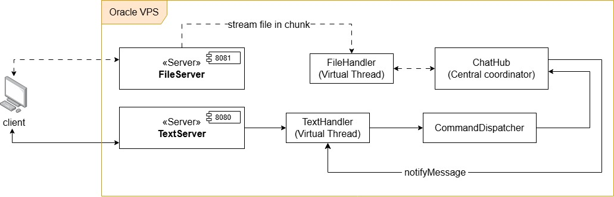

## SOAPTA
> The private chat application that help someone want to internal privacy message and doesn't want to use external apps. Deployed on oracle cloud free tier with web console version, you can also use terminal to connect to the server directly (this version will release as a docker image)

### Characteristics
- Build with java core version 21 (with standard library)
- Using commands: `/msg`, `/help`, `/list` .etc to call the function like using terminal console on web version
- Send file through another file server socket helping client continue chats even file is downloading without bloking message
- Design pattern:
    - Singleton: only one instance `ChatHub`, `TextServer`, `FileServer` can run at the runtime
    - Template: 
    - Builder:
    - Strategy:
    - Observer:

### System architechure diagram

1. Overview

2. Sequences

